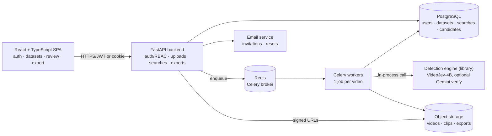
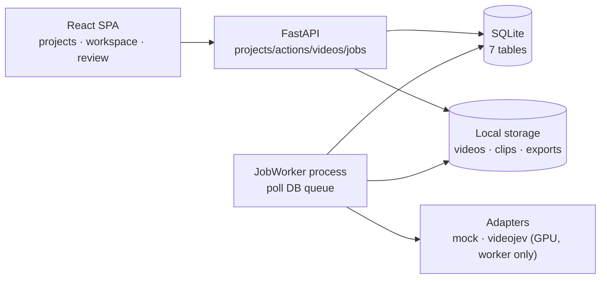

# Architecture — v1.2 target and current state

**Date:** 2026-11-12 · **Status:** target for the v1.1 requirements; current repository implements a narrower
slice · **See also:** [DESIGN_DESCRIPTION.md](DESIGN_DESCRIPTION.md), [API_CONTRACTS.md](API_CONTRACTS.md),
[DATABASE_SCHEMA.md](DATABASE_SCHEMA.md).

> **As-built detail for the implemented prototype:** [docs/as-built/IMPLEMENTED_BASELINE_2026-11-05.md](as-built/IMPLEMENTED_BASELINE_2026-11-05.md).

## 1. Drivers

| Driver | Consequence |
|---|---|
| Detection can take hours (NFR-3) | Search and export are asynchronous jobs; HTTP only enqueues |
| Videos may contain faces (NFR-8) | Self-hosted detector by default; cloud API only with written approval; signed media URLs |
| Roles are global, access is per dataset (CE-2) | Authorization on every route; dataset scoping for Dataset Administrators |
| The model may change (NFR-6) | One `GroundingBackend` interface; model pinned per `ModelConfig` |
| 12 GB VRAM available, 24 GB maybe | Windowed processing, low-VRAM profile, quantisation |
| Distributed team, 7 sprints | Modular services, Docker Compose, stable contracts |

## 2. Target architecture

| Component | Responsibility |
|---|---|
| SPA | Sign-in, invitation acceptance, dataset pages, upload with progress, search launch, cross-video review, export, user management |
| API | Authentication, RBAC + dataset scoping, upload registration, search/export job creation, polling, signed media links |
| Queue/workers | Fan out one detection job per video; aggregate search state; persist candidates; cut preview clips |
| Detection engine | `video_grounding/` library: windowed grounding, fusion, completeness flags, resume, optional clip export and Gemini verify, KPI evaluation CLI. Runs in the worker process; no HTTP server |
| PostgreSQL | Metadata, users, assignments, searches, candidates, review state |
| Object storage | Source videos, preview clips, JSON/clip export artifacts |
| Email | Invitations (48 h single-use) and password resets |

**Deployment:** Docker Compose on a single host (API, workers, Redis, PostgreSQL, MinIO, engine with GPU
profile, web build). The engine is a library loaded by the GPU worker; splitting it into a separate service is
not built (see §4).

## 3. Current repository (verified 2026-11-12)

- One API process + one worker process; queue in the database (`UPDATE … WHERE status='queued'`), no Redis.
- **Heartbeat lease** (ADR-0001 amendment). A worker owns a job while `status='running' AND attempts=<value it
  claimed with>` (`attempts` is the fencing token). Every commit of a job (progress, finish, failure) first runs
  a conditional `UPDATE … SET updated_at` on that predicate; zero rows means the job was canceled or reclaimed,
  so the worker rolls back, drops its result and moves on. A daemon thread in the worker also touches
  `updated_at` every `VLM_WORKER_HEARTBEAT_SECONDS`, because the VLM engine can be silent for minutes (model
  load, offloaded windows). Before each claim the worker **reaps** running jobs whose `updated_at` is older
  than 3 beats: requeued with `error_code=WORKER_LOST`, or failed (export included) when attempts are
  exhausted, so a job that kills the worker every time cannot loop forever. The `videojev` adapter then
  resumes from its per-job engine dir.
- **Cancel** applies to queued and running jobs. A running worker notices at its next progress tick (one engine
  window), so cancel latency is one window, and its late result is never written. A linked export fails with
  "canceled".
- Known limit: `updated_at` is stamped with worker clocks, so several worker hosts need synchronized clocks.
- SQLite with WAL; Alembic migration verified. PostgreSQL-compatible models but untested.
- Local storage behind a `StorageBackend` protocol; generated keys, traversal guard.
- Optional single bearer token enforced in middleware; **no users/roles/datasets**.
- Adapters: `mock` (CI default), `videojev` (real detector, the `video_grounding/` engine with VideoJev-4B, run
  in the worker process only; [ADR-0007](decisions/ADR-0007-videojev-zero-shot-grounding-adapter.md)), and a
  registered `qwen2.5-vl` stub. The `videojev` adapter is *exhaustive* (all events kept, zero events is
  success), resumes from a per-job work dir `data/storage/engine/job-<id>/` on retry, and loads the model once
  per worker. `POST /projects/{id}/actions/{id}/jobs` queues one job per video. It also keeps a per-video
  visual feature cache under `data/storage/engine/features/` (see "Visual feature cache" below).
- Export is a ZIP with `manifest.json` + `labels.csv` + clips (not OpenLABEL JSON).

### Visual feature cache

**What.** The worker stores each video window's visual features (the expensive decode + visual-encode step) on
its own disk. A later search on the same video skips that step. Results are identical: verified bit-exact on
180 window predictions and 28 events. The job config hash ignores the cache, so it never blocks a resume.

**Used (cache hit)** when the worker runs a search on a video that an earlier search already processed with the
same model and sampling settings:

- adding a new search to a project whose videos were already searched;
- "Run pending searches" over existing videos;
- re-running or retrying a search;
- engine CLI scans with several prompts, which share refine tiles at the same positions.

**Not used:**

- the first search on a video (it fills the cache);
- after changing the model or revision, sampling fps/frames, context, attention implementation, or upgrading
  torch/transformers (the keys change; old entries age out);
- on a different worker host (each host has its own cache);
- after LRU eviction;
- for the same file uploaded again as another video (the cache is per video);
- when `feature_cache.dir: null`.

**Saves vs. does not save.** It saves decoding and visual encoding: on the 8 GB laptop a later search on the
same 5-7 min video took 39-53% less time
([`video_grounding/docs/PERFORMANCE.md`](../video_grounding/docs/PERFORMANCE.md)). It does not save per-search
scoring, refine tiles at new positions, clip cutting, or backend preview extraction.

**Where and how big.** `data/storage/engine/features/video-<id>/` in the product (engine CLI:
`~/.cache/video_grounding/features`). Measured: one 8-prompt search of a 307 s cooking video left 1.9 GB
(15 coarse windows and 50 refine tiles, about 29 MB per entry); size grows with video length and with the
number of refine tiles. The cap is global across all videos (`feature_cache.max_gb`, default 50)
and evicts the least recently used entries.

**Deletion.** Deleting a video or a project removes its features and its `engine/job-<id>/` work dirs. Deleting
a search keeps the video's features (other searches use them). Deleting the whole features directory is always
safe: it only costs speed.

**Tests:** 98 backend (pytest; on macOS the Windows-path case `test_path_for_rejects_traversal[..\\escape.mp4]` fails, as it does on main), 21 UI (vitest), real-ffmpeg smoke 26/26; adapter tests use a fake engine (`backend/tests/test_videojev.py`), the engine has its own tests (`video_grounding/tests`). The real model ran through the API and worker on the RTX 3070 laptop on 2026-11-22: two videos, two prompts each, with video and project deletes clearing the feature cache (`video_grounding/docs/PERFORMANCE.md`).

## 4. Gap and migration plan

| Target element | Current | Migration |
|---|---|---|
| PostgreSQL | SQLite | Keep models portable; add Compose service; run migrations; test |
| Redis + Celery | DB queue | Introduce Celery only if throughput/parallelism demands it; otherwise keep DB queue as a documented simplification (decide Sprint 3) |
| Object storage | Local FS | Implement `StorageBackend` for S3/MinIO; signed URL issuance belongs to the API |
| Users/roles/invitations | Bearer token | New auth module, tables and screens; RBAC middleware; dataset scoping |
| Dataset/Search domain | Project/Action | Rename + new entities; data migration for existing rows; adapt UI |
| Detection engine | `videojev` adapter in the worker (in-process) | Separate engine service + Gemini backend only if GPU hosting must be split from the worker |
| JSON export | ZIP/CSV | New async export job writing the schema in Design §9 |
| Signed media URLs | Token or open | Time-limited signed URLs/cookies so `<video>` works (also fixes R-18) |

## 5. Key flows (target)

### 5.1 Search fan-out

1. `POST /api/datasets/{id}/searches` validates access and creates `Search(status=queued)`.
2. API enqueues one job per video (Celery) and returns `202 {search_id}`.
3. A worker calls the engine in-process for each video (`videojev` adapter; progress callback updates the job),
   receives events, writes candidates and cuts preview clips.
4. Search state aggregates child jobs; partial failures are reported per video (NFR-9).
5. The client polls `GET /api/searches/{id}`.

### 5.2 Review

`GET /api/searches/{id}/candidates` returns one paginated list across all videos with filters (video, review
status, confidence). `PATCH /api/candidates/{id}` stores final timestamps, `accepted/rejected`, reviewer and
time; raw proposal values are never overwritten.

### 5.3 Export

`POST /api/exports` → `202`; worker collects accepted (and optionally rejected) annotations, re-cuts adjusted
clips, writes JSON (schema in Design §9) to object storage; `GET /api/exports/{id}` exposes status + signed
download URL.

## 6. Failure handling

| Failure | Behaviour |
|---|---|
| Engine unavailable / model OOM | Job retried with fewer frames (ENG-11); after retries, per-video failure reported; search completes partially |
| Window failure | Window marked coverage gap; search flags it (ENG-4) |
| Worker crash | Job journal resumes finished windows (ENG-9); search can be retried |
| API rate limit (Gemini 429) | Only if engine verify is on (off in the `videojev` adapter); exponential backoff with a daily budget guard |
| Upload invalid | 4xx with error envelope; file not retained |
| Session expiry during review | Client keeps unsaved edits and replays after re-authentication (NFR-13) |

## 7. Security architecture

- TLS everywhere; http-only cookies or short-lived JWT with refresh rotation (decision pending).
- Passwords hashed (Argon2id/bcrypt); invitation tokens stored hashed, single-use, 48 h.
- RBAC middleware + per-dataset authorization; deny by default.
- Signed, short-lived media URLs; no public object buckets.
- Upload validation: extension + MIME + container signature + size + duration + probe.
- Secrets only in environment/secret store; Gemini key never in Git.
- Audit-relevant fields: `created_by`, `reviewer_id`, timestamps; deletion cascades; users deactivated not deleted.

## 8. Scaling path

1. More workers (Celery) and a second GPU engine instance.
2. Object storage + CDN for signed media.
3. Read replicas for review-heavy datasets.
4. Batch scheduling per dataset to respect API quotas.

## 9. Open architectural decisions

Auth scheme (cookie vs JWT) · stack migration scope (Celery/Redis/Postgres/MinIO vs keep DB queue for MVP) ·
engine deployment target (12 GB laptop vs 24 GB GPU vs API) · signed-URL issuer (API vs storage) · retention
policy.
