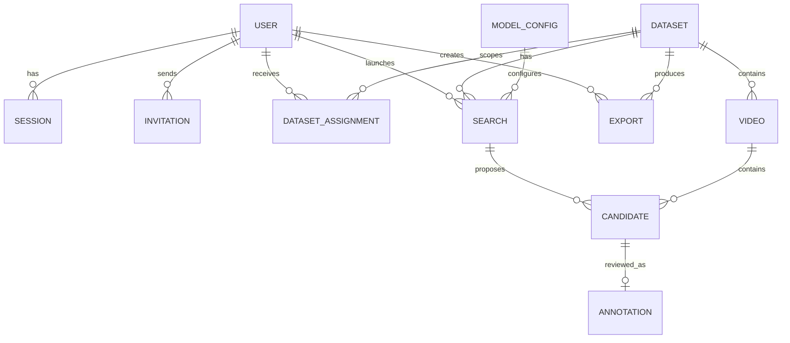

# Database Schema — v1.2 target and current state

**Date:** 2026-11-12 · **Target:** PostgreSQL · **Current:** SQLite with Alembic migrations
**Implemented schema today:** 7 tables in `backend/app/models.py` (see §6).

> **As-built detail for the implemented prototype:** [docs/as-built/IMPLEMENTED_BASELINE_2026-11-05.md](as-built/IMPLEMENTED_BASELINE_2026-11-05.md).

## 1. Target entity–relationship model

> The review decision may live directly on `Candidate` (as in the team's v1.1 design: `review_status`,
> `reviewer_id`, `reviewed_at`, final times) or in a separate `Annotation` row. The team design uses candidate
> fields; the current implementation uses a separate annotation row. Pick one in Sprint 3; this document shows
> candidate fields for compatibility with v1.1.

## 2. Target tables

### 2.1 `users`

| Column | Type | Constraints |
|---|---|---|
| id | uuid | PK |
| email | text | **unique**, not null, lower-cased |
| full_name | text | not null |
| organization | text | nullable |
| password_hash | text | not null (Argon2id/bcrypt) |
| role | enum | `administrator`, `annotator`, `dataset_admin`; **global** |
| status | enum | `active`, `deactivated` (USR-7) |
| failed_sign_ins | int | default 0; reset on success |
| locked_until | timestamptz | nullable (NFR-14) |
| created_at, updated_at | timestamptz | not null |

### 2.2 `invitations`

| Column | Type | Constraints |
|---|---|---|
| id | uuid | PK |
| email | text | not null |
| role | enum | as `users.role` |
| invited_by | uuid | FK users(id) |
| token_hash | text | **unique**, not null; single-use |
| expires_at | timestamptz | not null; **48 h** (NFR-11) |
| used_at | timestamptz | nullable |
| dataset_ids | uuid[] | optional initial assignment |

### 2.3 `sessions`

| Column | Type | Constraints |
|---|---|---|
| id | uuid | PK |
| user_id | uuid | FK users, CASCADE |
| refresh_token_hash | text | unique, not null |
| last_activity_at | timestamptz | not null (2 h inactivity, NFR-13) |
| expires_at | timestamptz | not null |
| revoked_at | timestamptz | nullable (NFR-12) |

### 2.4 `datasets`

| Column | Type | Constraints |
|---|---|---|
| id | uuid | PK |
| name | text | not null |
| use_case | text | not null |
| created_by | uuid | FK users |
| created_at | timestamptz | not null |

### 2.5 `dataset_assignments`

| Column | Type | Constraints |
|---|---|---|
| user_id | uuid | FK users, CASCADE |
| dataset_id | uuid | FK datasets, CASCADE |
| assigned_by | uuid | FK users |
| assigned_at | timestamptz | not null |
| — | — | **PK (user_id, dataset_id)** |

### 2.6 `videos`

| Column | Type | Constraints |
|---|---|---|
| id | uuid | PK |
| dataset_id | uuid | FK datasets, CASCADE, indexed |
| file_name | text | not null (metadata only) |
| storage_key | text | **unique**, not null (generated) |
| checksum_sha256 | text | not null |
| duration_s | numeric | not null after probe |
| resolution | text | e.g. `1920x1080` |
| status | enum | `uploaded`, `ready`, `failed` |
| summary | text | nullable; EXP-3 (non-MVP) |
| tags | text[] | default `{}`; EXP-3 |
| created_at | timestamptz | not null |

### 2.7 `searches`

| Column | Type | Constraints |
|---|---|---|
| id | uuid | PK |
| dataset_id | uuid | FK datasets, CASCADE, indexed |
| prompt | text | not null |
| model_config_id | uuid | FK model_configs |
| status | enum | `queued`, `running`, `done`, `failed` (indexed with dataset_id) |
| created_by | uuid | FK users |
| created_at, finished_at | timestamptz | |
| error_message | text | nullable |
| progress | numeric | 0..1 |

### 2.8 `model_configs`

| Column | Type | Constraints |
|---|---|---|
| id | uuid | PK |
| provider_type | enum | `api`, `self_hosted` |
| model_name | text | e.g. `gemini-2.5-flash`, `videojev-4b` |
| revision | text | pinned model revision/hash |
| frame_rate | numeric | sampling rate |
| resolution | int | max frame size |
| parameters | jsonb | prompt template version, thresholds |

### 2.9 `candidates`

| Column | Type | Constraints |
|---|---|---|
| id | uuid | PK |
| search_id | uuid | FK searches, CASCADE, indexed |
| video_id | uuid | FK videos, CASCADE |
| engine_event_id | text | stable hash; unique per (search_id, engine_event_id) |
| original_start_s, original_end_s | numeric | raw model output, never overwritten |
| start_s, end_s | numeric | final times; `CHECK 0 ≤ start_s < end_s` |
| confidence | numeric | sorting only, not calibrated |
| preview_key | text | object-storage key |
| review_status | enum | `pending`, `accepted`, `rejected` |
| reviewer_id | uuid | FK users, nullable |
| reviewed_at | timestamptz | nullable |
| needs_review | boolean | from ENG-6 |
| review_reasons | text[] | e.g. `touches_video_start`, `sparse_sampling_boundary` |
| created_at | timestamptz | not null |

Index: `(search_id, review_status)` for the review list; `(video_id)`.

### 2.10 `exports`

| Column | Type | Constraints |
|---|---|---|
| id | uuid | PK |
| dataset_id | uuid | FK datasets, CASCADE |
| search_id | uuid | FK searches, nullable |
| status | enum | `queued`, `running`, `done`, `failed` |
| include_rejected | boolean | default false |
| storage_key | text | nullable until done |
| item_count | int | default 0 |
| created_by | uuid | FK users |
| created_at, finished_at | timestamptz | |
| error_message | text | nullable |

## 3. Enumerations

| Enum | Values |
|---|---|
| role | administrator, annotator, dataset_admin |
| user status | active, deactivated |
| video status | uploaded, ready, failed |
| search status / export status | queued, running, done, failed |
| review status | pending, accepted, rejected |
| provider type | api, self_hosted |

## 4. Constraints and indexes

- Unique: `users.email`, `invitations.token_hash`, `sessions.refresh_token_hash`, `videos.storage_key`.
- Composite PK: `dataset_assignments(user_id, dataset_id)`.
- Checks: candidate `start_s < end_s`, `0 ≤ start_s`, `duration_s > 0`, `progress BETWEEN 0 AND 1`.
- Indexes: `videos(dataset_id)`, `searches(dataset_id, status)`, `candidates(search_id, review_status)`,
  `candidates(video_id)`, `exports(dataset_id, created_at)`.
- Cascades: deleting a dataset deletes videos/searches/candidates/assignments/exports; users are deactivated,
  never deleted (review history preserved).

## 5. Migration path from the current schema

| Current table | Target |
|---|---|
| projects | datasets (+ created_by, use_case) |
| action_definitions | searches (prompt per search) |
| videos | videos (dataset_id, storage_key, checksum kept) |
| processing_jobs | removed as a user-facing concept; job state moves into `searches` + internal job journal; Celery/queue replaces the DB queue if adopted |
| candidates | candidates (+ engine_event_id, flags, reviewer fields, final/raw times) |
| annotations | merged into candidates (`review_status`, reviewer, times) or retained as an audit table |
| dataset_exports | exports (JSON artifact instead of ZIP manifest) |
| — | new: users, invitations, sessions, dataset_assignments, model_configs |

Alembic migrations must be additive first (create new tables), then a data migration for existing rows, then
drop the old tables. No destructive migration before the team agrees.

## 6. Current implemented schema (verified 2026-11-24)

SQLite `data/vlm_annotate.db`, migrations `0001_initial_schema.py`, `d03f1c4ffd30_auth_and_datasets.py`,
`e5b9c3d7a2f1_search_and_search_video.py`, `c9f0d3a1b2e4_nullable_processing_job_project.py` and
`f1a4b8c2d6e9_search_idempotency_key.py`:

| Table | Purpose |
|---|---|
| projects | project container (≈ dataset) |
| action_definitions | natural-language prompt per project |
| videos | uploaded source, storage key, checksum, duration, resolution, status; `project_id` now nullable, `dataset_id` nullable FK |
| processing_jobs | DB queue + provenance (`queued/running/succeeded/failed/canceled`, attempts, idempotency); `project_id` now nullable for dataset searches |
| candidates | proposal + preview + clip status + score; `search_id` nullable FK |
| annotations | human decision (`true_positive`/`false_positive`), corrections, reviewer, note |
| dataset_exports | async ZIP exports (still project-scoped) |
| users | global role (`administrator`/`dataset_admin`/`annotator`), password hash, lockout state |
| invitations | single-use email invitation; only the token hash is stored |
| user_sessions | opaque bearer session; token hash, expiry and revocation |
| datasets | dataset container for the Sprint 3 access model |
| dataset_memberships | which user may see/annotate a dataset (roles stay global) |
| searches | one free-text prompt run over a dataset; `status` (`queued`/`running`/`done`/`partial`/`failed`), auto `title`, optional unique `idempotency_key` |
| search_videos | one row per (search, video): `search_id`, `video_id`, nullable `job_id -> processing_jobs.id`, per-video `status` |

Migrations `0002` (`d03f1c4ffd30`) and `0003` (`e5b9c3d7a2f1`) were verified on a fresh SQLite file with
`alembic upgrade head` and `alembic check` (no pending operations); the API was exercised against that migrated
schema without `create_all` (bootstrap → login → create dataset). **14 tables total**, migration head is
`f1a4b8c2d6e9` (migration `0005`/`f1a4b8c2d6e9` was written on 2026-11-24 and has not been applied in this
working copy yet — run `alembic upgrade head` to confirm). The schema is portable to PostgreSQL but has not
been tested there (R-09).

`search_videos` is the join that replaced the "one job per video" view: a `Search` aggregates the status of its
`SearchVideo` rows, while each row keeps pointing at the underlying `processing_jobs` job that the worker executes.
Automated tests for this layer live in `backend/tests/test_searches.py` (added 2026-11-21: fan-out, status
aggregation, role + dataset scoping).
